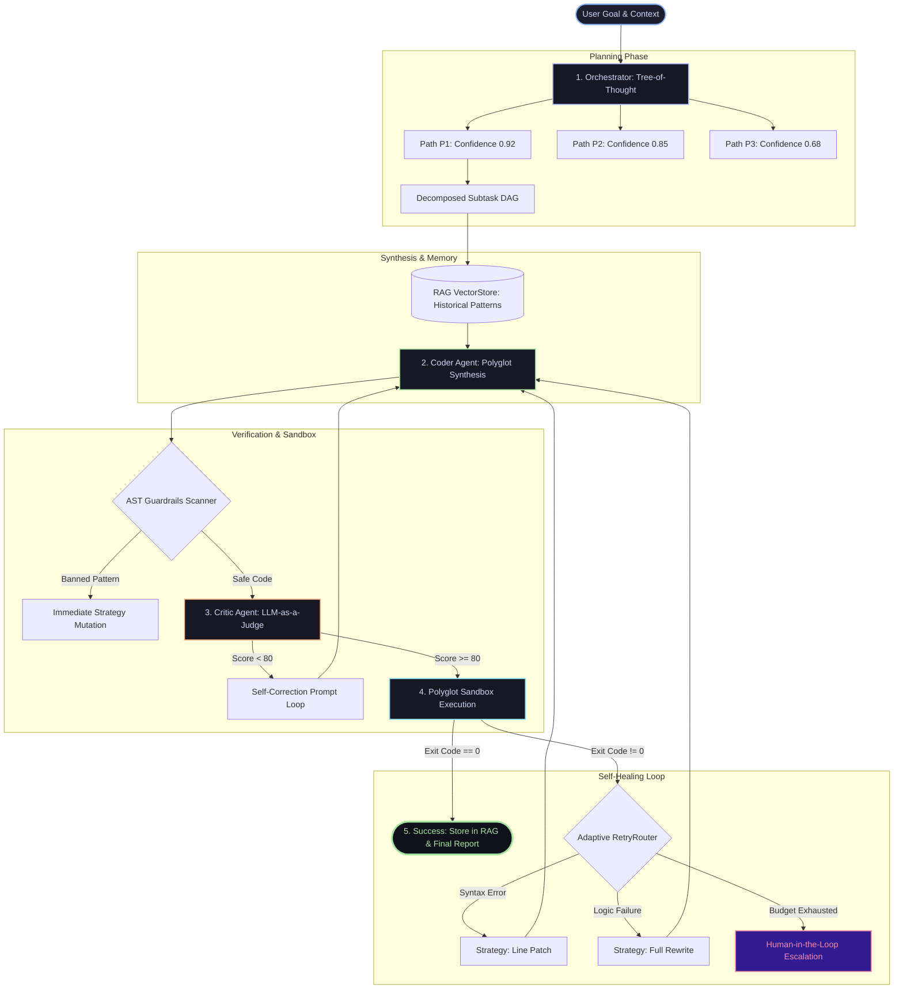

<div align="center">

# 🛡️ Sentinel AI 2.0
### Autonomous Self-Correcting Multi-Agent Software Engineering Platform

[](https://www.python.org/)
[](https://fastapi.tiangolo.com/)
[](https://react.dev/)
[](https://www.typescriptlang.org/)
[](https://vitejs.dev/)
[](https://tailwindcss.com/)
[](https://opensource.org/licenses/MIT)

**[Live Web App (Vercel)](https://sentinel-ai-private.vercel.app/)** • **[Backend API & ZeroGPU Space (Hugging Face)](https://soumik041-sentinel-ai.hf.space)** • **[Documentation Index](#-documentation-index)**

<p align="center">
  <em>Sentinel AI is a production-grade, distributed multi-agent system designed to solve complex software engineering challenges. It combines Tree-of-Thought planning, specialized subtask synthesis, LLM-as-a-Judge semantic auditing, sandboxed polyglot compilation/execution (Python, Go, Rust, C, C++, JavaScript), long-term RAG vector memory, and self-healing failure recovery.</em>
</p>

---

</div>

## 📌 Executive Summary

Modern LLMs struggle with multi-step algorithmic problem solving, complex compilation constraints, edge-case validation, and runtime error recovery. **Sentinel AI 2.0** replaces monolithic single-prompt generation with a **decoupled, self-correcting multi-agent architecture** that mirrors real-world software engineering teams:

1. **Strategic Planning:** An Orchestrator evaluates 3 distinct candidate paths with confidence metrics before decomposing a goal.
2. **Context-Aware Synthesis:** Coder queries a persistent Turso (`libSQL`) + FAISS RAG vector store for historical solutions and generates full-file implementations across 6 polyglot languages.
3. **Pre-Execution Guardrails:** A structural AST scanner rejects unsafe system patterns before code touches disk or hardware.
4. **LLM-as-a-Judge Review:** A specialized Critic audits the code against correctness, edge cases, acceptance criteria, and cleanliness (rejecting below score 80).
5. **Sandboxed Polyglot Execution:** Isolated execution engine enforces virtual memory caps, CPU time limits, and compilation toolchains for Python, Go, Rust, C, C++, and Node.js.
6. **Adaptive Recovery:** If a test or compilation fails, the RetryRouter analyzes stderr and mutates repair strategies (syntax patching, algorithmic rewriting, or human escalation).

---

## 🏗️ Architecture & Execution Pipeline



---

## ⚡ Key Platform Capabilities

<details open>
<summary><b>1. Multi-Language Polyglot Sandboxing</b></summary>
<br>

Sentinel AI 2.0 is not limited to Python. It features native, sandboxed compilation and execution across 6 primary systems and scripting languages:

| Language | Runtime / Compiler | File Extension | Isolation Guardrails |
| :--- | :--- | :---: | :--- |
| **Python** | Python 3.11 / 3.12 | `.py` | AST pre-execution scanner, memory capping |
| **Golang** | Go 1.22+ (`go run` / `go build`) | `.go` | `GOMAXPROCS=1`, `CGO_ENABLED=0`, memory sandbox |
| **Rust** | Rustc / Cargo (`rustc -O`) | `.rs` | Virtual memory limits, subprocess isolation |
| **C** | GCC (`gcc -O2 -Wall -Wextra`) | `.c` | Static bounds checking, heap allocator validation |
| **C++** | G++ (`g++ -O2 -std=c++20`) | `.cpp` | Virtual memory sandbox, wall-clock timeout |
| **JavaScript** | Node.js v20+ / v24+ | `.js` | Isolated V8 runtime context, execution timeout |

</details>

<details open>
<summary><b>2. Resilient 7-Provider LLM Tier Routing</b></summary>
<br>

To ensure 99.9% uptime and zero-cost or cost-optimized execution, Sentinel AI incorporates a dynamic multi-provider routing matrix with automated rate-limit recovery and health-checking:

```
[Tier 1: Ultra-Fast Inference]  ──► Groq (Llama 3.3 70B, GPT-OSS 120B)
           │ (Fail / 429)
[Tier 2: High-Context Reasoning] ──► NVIDIA NIM (Nemotron 70B, Gemma 4 31B)
           │ (Fail / 429)
[Tier 3: Free Tier Aggregator]   ──► OpenRouter (Free DeepSeek R1, Llama 3)
           │ (Fail / 429)
[Tier 4: Enterprise Scale]       ──► SambaNova / OpenCode / Cohere / Cerebras
           │ (Fail / Offline)
[Tier 5: Local Air-Gapped Fallback] ──► Local Ollama / vLLM Offline Protocol
```

</details>

<details>
<summary><b>3. LLM-as-a-Judge Code Review (Critic Agent)</b></summary>
<br>

Before executing any code, the Critic agent independently parses the synthesized source and scores it across four orthogonal dimensions:
- **Correctness (0-10):** Algorithmic validity, logic soundness, and mathematical correctness.
- **Edge Cases (0-10):** Handling of empty inputs, boundary values, integer overflow, and off-by-one errors.
- **Acceptance Criteria (0-10):** Strict adherence to the user's requirements and constraints.
- **Maintainability & Cleanliness (0-10):** Docstrings, inline annotations, idiomatic language patterns.

If the aggregate normalized score is **`< 80`**, the code is automatically rejected with explicit critique feedback sent back to the Coder for targeted revision.
</details>

<details>
<summary><b>4. AST Safety & Prohibited Pattern Shield</b></summary>
<br>

All Python scripts are subjected to a rigorous AST inspection before execution. Sentinel AI blocks:
- Arbitrary subprocess executions (`subprocess`, `os.system`, `pty`).
- Destructive file system modifications (`shutil.rmtree`, `os.remove`, `os.rmdir`).
- Raw network socket binding (`socket`, `urllib.request`, `requests` unless explicitly permitted).
- Unsafe memory introspection (`ctypes`, `__import__`).
</details>

<details>
<summary><b>5. Long-Term RAG Vector Memory</b></summary>
<br>

Sentinel AI persists historical patterns and run telemetry in **Turso (`libSQL`)** using native `F32_BLOB(256)` vector embeddings and `vector_distance_cos` similarity over Hrana HTTP v2 (with automatic local FAISS / SQLite fallback when offline).
- **Success Recall:** Every solved problem and passing test suite is indexed in the `memories` table. When new goals are received, the Coder agent retrieves the top-$k$ most similar implementations to seed its context.
- **Failure Adaptation:** Common error patterns and their successful resolution strategies are stored to prevent repeating past mistakes.
</details>

---

## 📊 Benchmark Results

Measured on the standardized 12-task Evaluation Lab benchmark suite (`eval_1791864368`):

| Evaluation Metric | Baseline (Self-Correction OFF) | Sentinel AI 2.0 (Self-Correction ON) | Net Performance Lift |
| :--- | :---: | :---: | :---: |
| **Task Completion Rate** | **75.0%** (9 / 12) | **100.0%** (12 / 12) | **+25.0%** (+33.3% relative lift) |
| **Total Self-Corrections** | **0** | **8** | Fully autonomous self-healing |
| **Avg. Corrections / Task** | **0.00** | **0.67** (2.67 on healed tasks) | Zero human intervention needed |
| **Average Subtask Steps** | **2.75** | **2.75** | Optimal plan density |
| **Average Token Cost** | **$0.014** | **$0.023** | Nominal cost for guaranteed correctness |

*See [`docs/BENCHMARK_REPORT.md`](./Sentinel%20AI/docs/BENCHMARK_REPORT.md) for full individual trace logs, error distributions, and timing breakdowns.*

---

## 🚀 Getting Started

### 1. Prerequisites
- **Python:** 3.11 or 3.12
- **Node.js:** v18.0.0 or higher (v20+ recommended)
- **Compilers (Optional for Polyglot execution):** `gcc`, `g++`, `golang-go`, `rustc`
- **LLM API Key:** At least one free API key from [Groq](https://console.groq.com/), [NVIDIA NIM](https://build.nvidia.com/), [OpenRouter](https://openrouter.ai/), or [OpenAI](https://platform.openai.com/).

---

### 2. Quick Installation

```bash
# Clone the repository
git clone https://github.com/Soumik-Dev-Ai/Sentinel-Ai-private.git
cd Sentinel-Ai-private/v2

# Set up Python virtual environment
python -m venv .venv
# Windows:
.\.venv\Scripts\activate
# Linux/macOS:
source .venv/bin/activate

# Install backend dependencies
pip install -r requirements.txt

# Configure environment variables
cp .env.example .env
# Edit .env and paste your API keys (e.g., GROQ_API_KEY=your_key_here)
```

---

### 3. Running Locally

#### Start Backend (FastAPI + WebSockets)
```bash
uvicorn backend.server.server:app --reload --port 8000
```
*Health check endpoint:* `http://localhost:8000/health`  
*WebSocket streaming endpoint:* `ws://localhost:8000/ws/run`

#### Start Frontend (React + Vite)
```bash
cd frontend
npm install
npm run dev
```
*Open [http://localhost:5173](http://localhost:5173) in your browser.*

---

### 4. Docker Deployment

Sentinel AI includes a production-ready `Dockerfile` equipped with Python 3.12, Golang, GCC/G++, Rustc, and Node.js:

```bash
# Build Docker image
docker build -t sentinel-ai:2.0 .

# Run container
docker run -p 8000:8000 -p 7860:7860 --env-file .env sentinel-ai:2.0
```

---

## 📡 WebSocket API Protocol

The frontend communicates with the backend in real time via `ws://<host>:<port>/ws/run`.

### Client Initiates Run:
```json
{
  "type": "start",
  "goal": "Write a recursive semi-palindrome partition solver with unit tests in Go.",
  "input": "String s = 'abcabc', k = 2",
  "mode": "multi"
}
```

### Server Event Stream:
| Event Type | Description |
| :--- | :--- |
| `agent_started` | Indicates which agent (Orchestrator, Coder, Critic, Executor) is currently acting. |
| `graph_node` | Incremental node updates for the real-time ReactFlow execution tree. |
| `code_written` | Emitted when Coder synthesizes or patches a source file. |
| `critic_verdict` | Scores, feedback, and PASS/FAIL verdict from Critic. |
| `code_executed` | Sandbox execution output (`exit_code`, `stdout`, `stderr`, duration). |
| `telemetry_update` | Live token counters, cumulative USD cost, and per-agent token breakdown. |
| `needs_human_review`| Triggered when an agent requests clarification or confirmation on low confidence. |
| `completed` | Final report, overall metrics, and generated artifacts payload. |

---

## 📂 Repository Structure (v1 vs v2 Architecture)

```text
├── v1/                             # Version 1.0 — Original Single-Agent ReAct System
│   ├── backend/                    # Original ReAct loop, tools, and router
│   ├── frontend/                   # Original React dashboard
│   ├── docs/                       # v1 documentation specifications
│   ├── reports/                    # v1 test reports & artifacts
│   ├── requirements.txt            # v1 dependencies
│   └── README.md                   # v1 architecture summary
│
├── v2/                             # Version 2.0 — Multi-Agent Self-Correcting Platform
│   ├── app.py                      # ZeroGPU entry point (FastAPI + Gradio)
│   ├── Dockerfile                  # Multi-stage polyglot container specification
│   ├── packages.txt                # Linux distribution packages (gcc, go, rustc, nodejs)
│   ├── requirements.txt            # v2 dependencies
│   ├── backend/
│   │   ├── config.py               # Centralized configuration & environment loader
│   │   ├── eval_suite.py           # Evaluation Lab automated benchmark runner
│   │   ├── ai_agent/               # Long-term semantic working memory & vector index
│   │   ├── llm/                    # 7-Provider resilient router & provider adapters
│   │   ├── orchestrator/           # Multi-agent core (Orchestrator, Coder, Critic, Executor)
│   │   ├── recovery/               # Adaptive failure categorization & strategy mutation
│   │   ├── server/                 # FastAPI REST and WebSocket server endpoints
│   │   ├── telemetry/              # Distributed span tracing & real-time cost calculation
│   │   ├── tools/                  # Polyglot sandbox execution engine & AST guardrails
│   │   └── tests/                  # Unit tests (155+ offline tests) & merciless E2E suites
│   ├── docs/                       # Technical specifications, PRD, and architecture reports
│   │   ├── ARCHITECTURE.md         # Detailed system architecture & sequence diagrams
│   │   ├── BENCHMARK_REPORT.md     # 12-task benchmark analysis & metrics
│   │   ├── PRD.md                  # Product Requirements Document
│   │   ├── TECH_STACK.md           # Technology stack & provider matrix
│   │   └── legacy_v1/              # Archived v1.0 documentation
│   └── frontend/                   # Modern React 18 + Vite + Tailwind CSS web dashboard
│       ├── src/
│       │   ├── components/         # HeroSection, AgentWorkspace, ExecutionGraph, Telemetry
│       │   ├── hooks/              # useAgentSocket (real-time WebSocket state management)
│       │   └── services/           # REST API client & evaluation bridge
│       └── package.json            # Frontend dependencies & build scripts
│
└── README.md                       # Root Repository Index & Quickstart
```

---

## 📚 Documentation Index

- **[System Architecture (ARCHITECTURE.md)](./v2/docs/ARCHITECTURE.md)**: Deep dive into the multi-agent state machine, WebSocket lifecycle, and IPC protocol.
- **[Benchmark Report (BENCHMARK_REPORT.md)](./v2/docs/BENCHMARK_REPORT.md)**: Empirical comparison of Self-Correction ON vs OFF across 12 canonical tasks.
- **[Product Requirements Document (PRD.md)](./v2/docs/PRD.md)**: Functional requirements, user workflows, and error recovery specifications.
- **[Tech Stack Reference (TECH_STACK.md)](./v2/docs/TECH_STACK.md)**: Exhaustive breakdown of libraries, runtimes, and LLM providers.
- **[Testing & Verification Plan (TESTING_PLAN.md)](./v2/docs/TESTING_PLAN.md)**: Test suites, coverage requirements, and sandbox safety criteria.
- **[Version 1 Archive (v1/README.md)](./v1/README.md)**: Complete original Version 1.0 documentation.

---

## 📄 License

This project is open-source software licensed under the **[MIT License](https://opensource.org/licenses/MIT)**.
