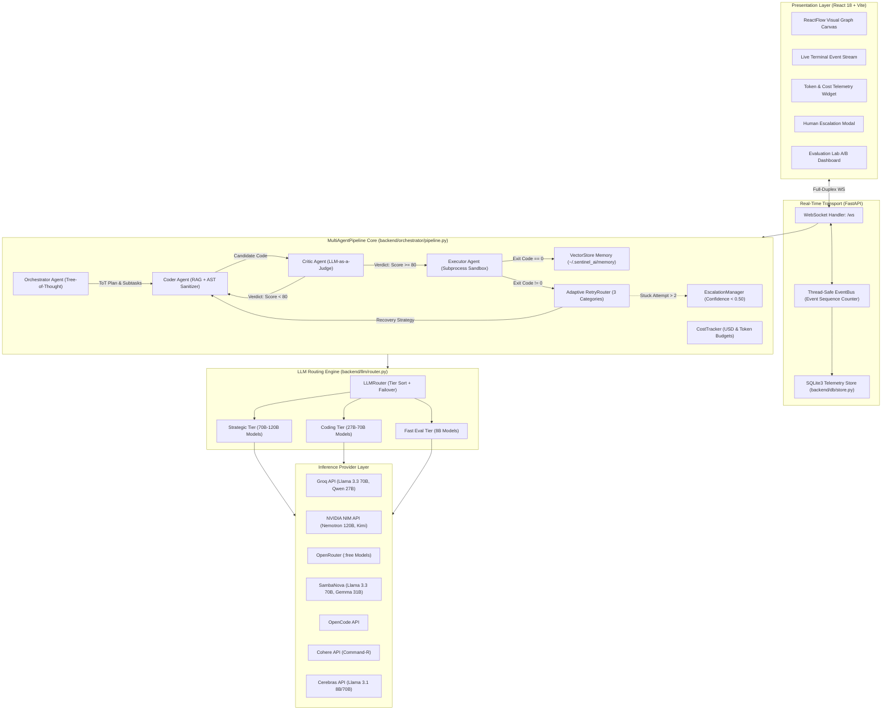
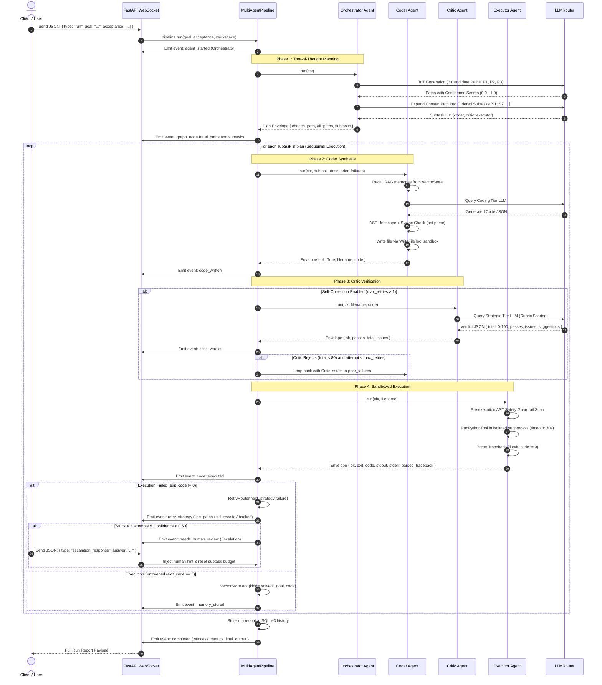

# Sentinel AI 2.0 — System Architecture Specification

## 1. Executive Architecture Overview

Sentinel AI 2.0 is an autonomous, multi-agent software engineering system that plans, writes, critiques, executes, and self-corrects Python code without external human intervention unless confidence drops below safe recovery bounds.

The system replaces single-agent ReAct (Reason + Act) loops with a coordinated team of specialist agents:
- **Orchestrator Agent**: Tree-of-Thought (ToT) strategic planning, candidate approach generation, confidence scoring, and dynamic subtask decomposition.
- **Coder Agent**: RAG-memory-informed code generation with automatic AST unescaping, snake_case module creation, and standard-library prioritization.
- **Critic Agent**: LLM-as-a-Judge reviewing code across 4 orthogonal dimensions (correctness, edge cases, acceptance, readability) against an 80/100 approval threshold.
- **Executor Agent**: Sandboxed subprocess execution with pre-execution AST safety scanning and structured traceback parsing.
- **Adaptive RetryRouter**: Heuristic classification of runtime errors into targeted recovery actions (`line_patch`, `full_rewrite`, `backoff`).
- **EscalationManager**: Confidence-triggered human-in-the-loop intervention modal when retries stall.
- **VectorStore Memory**: Local disk-backed TF-IDF semantic memory storing solved implementations and error recovery strategies.
- **Multi-Tier LLMRouter**: Free-tier-prioritized model routing across 7 providers with dynamic model discovery, reactive 429 backoff, and per-model token-per-day rotation.
- **Real-Time WebSocket Layer**: FastAPI WebSocket event bus delivering sub-15ms lifecycle events to a ReactFlow execution canvas.



---

## 2. Pipeline Execution Lifecycle & State Machine

The master coordinator [`MultiAgentPipeline`](file:///c:/Users/user/projects/self%20correcting%20multi%20agent/Sentinel%20AI/backend/orchestrator/pipeline.py) executes every user goal through a strictly managed lifecycle:



---

## 3. Detailed Component Specifications

### 3.1 Orchestrator Agent (`backend/orchestrator/orchestrator.py`)
- **System Prompt Specification:** Instructs the LLM to output exactly 3 distinct candidate approaches (`P1`, `P2`, `P3`) with rationale, risks, steps, and a confidence score ($0.0 - 1.0$) based on:
  $$\text{Confidence} = P(\text{code correctness}) \times P(\text{ease of verification}) \times P(\text{approach match})$$
- **Expansion Prompt:** Expands the selected highest-confidence path into 2–3 granular subtasks, enforcing typed agent assignments:
  - `agent`: `"coder" | "critic" | "executor"`
  - `model_tier`: `"strategic" | "coding" | "fast_eval"`
- **Graph Generation:** Adds nodes to `EventBus` (`plan_P1`, `plan_P2`, `plan_P3`, `S1`, `S2`, ...), marking rejected candidate branches as dimmed and the selected branch as active.

### 3.2 Coder Agent (`backend/orchestrator/coder.py`)
- **RAG-Driven Context:** Queries `VectorStore` using TF-IDF token matching over `f"{goal} {subtask_desc}"`. Injects top-$k$ past solved strategies into the system prompt.
- **AST Parser & Unescape Engine:** LLMs frequently emit double-escaped newlines (`\\n`) or literal backslashes when outputting JSON strings containing Python code. The Coder runs an automated sanitization pass:
  ```python
  if "\\n" in code:
      try:
          import ast
          ast.parse(code)
      except SyntaxError:
          fixed = code.replace("\\\n", "\n").replace("\\n", "\n").replace('\"', '"').replace("\'", "'")
          try:
              ast.parse(fixed)
              code = fixed
          except SyntaxError:
              pass
  ```
- **Fallback Extraction:** If the LLM violates the JSON envelope contract, a 2-stage regex parser recovers the code block:
  1. Searches for `"code"\s*:\s*"(.*?)"\s*(?:,\s*"(?:self_check|rationale|filename)"|\s*\})` with newline unescaping.
  2. Fallback scans for standard markdown fences `(?s)```(?:python|py)\s*\n(.*?)\n``` `.

### 3.3 Critic Agent (`backend/orchestrator/critic.py`)
- **LLM-as-a-Judge Rubric:**
  - `correctness` ($0 - 10$): Algorithmic correctness and logical flow.
  - `edge_cases` ($0 - 10$): Handling of empty inputs, boundary indices, nulls, and exceptions.
  - `acceptance` ($0 - 10$): Adherence to the prompt's explicit acceptance criteria.
  - `readability` ($0 - 10$): Idiomatic syntax, docstrings, and inline commentary.
- **Dynamic Score Normalization:** When models return an unscaled sum of the 4 axes ($0 - 40$) rather than a $0 - 100$ total, the Critic normalizes the score:
  $$\text{total} = \text{round}(\text{axis\_sum} \times 2.5)$$
- **Acceptance Threshold:** Code is accepted if $\text{total} \ge 80$. Rejections generate structured `issues` and `fix_suggestions` routed back into Coder context.

### 3.4 Executor Agent (`backend/orchestrator/executor.py`)
- **Pre-Execution AST Guardrail Scan:** Inspects the parsed AST for dangerous operations:
  - Banned standard library modules: `ctypes`, `socket`, `http.server`, `multiprocessing`, `signal`.
  - Dangerous function patterns: `os.system()`, `shutil.rmtree()`, `os.remove()`, dynamic `__import__()`, arbitrary `eval()` / `exec()` on non-literal strings.
- **Subprocess Sandbox:** Executes via `subprocess.run([sys.executable, filename])` in a designated temporary working directory with hard execution timeouts (default: 30s) and clean environment variable isolation.
- **Traceback Decomposition:** Deconstructs standard Python tracebacks into structured fields:
  ```python
  {
      "kind": "syntax" | "logic" | "external" | "unknown",
      "exception": "KeyError",
      "line": 42,
      "snippet": "val = data['missing_key']",
      "demands_strategy": "line_patch" | "full_rewrite" | "backoff"
  }
  ```
- **Benign Output Toleration:** Test execution tools (like `unittest`) output test run counts to `stderr` even on successful runs. The executor treats `exit_code == 0` as success if `stderr` does not contain `"Traceback"`, `"Error:"`, or `"FAILED"`.

### 3.5 Adaptive RetryRouter (`backend/orchestrator/retry.py`)
The retry router avoids blind repetitive re-prompting by mapping failure types to specific remediation instructions:
- **`LINE_PATCH` (Syntax Errors):** Targets specific line numbers without regenerating the entire file. Instructs Coder to check indentation, colons, or matching parentheses.
- **`FULL_REWRITE` (Logic Errors):** Fired on `AssertionError`, `ValueError`, `KeyError`, `IndexError`. Instructs Coder to reconsider algorithm, base cases, loop bounds, and data structures.
- **`BACKOFF` (External / Environment Failures):** Fired on timeouts or connection limits. Applies exponential backoff with random jitter:
  $$W = \min(W_{\max}, W_{\text{base}} \times 2^{\text{attempt} - 1}) + \text{jitter}$$

### 3.6 EscalationManager (`backend/orchestrator/escalation.py`)
- **Confidence Scoring:** Tracks moving average confidence across subtask attempts.
- **Trigger Conditions:** Fires when `attempts >= 2` and $\text{average\_confidence} < 0.50$.
- **Human Guidance Protocol:** Emits `needs_human_review` over WebSocket. The UI renders an interactive modal showing recent failures and a targeted clarifying question. When answered, the pipeline appends the human advice to the Coder context and resets the retry budget.

### 3.7 VectorStore Memory (`backend/memory/vector_store.py`)
- **Storage:** Persisted locally as JSON records in `~/.sentinel_ai/memory/memory.json`.
- **Indexing & Retrieval:** Computes TF-IDF token weights over vocabulary extracted from goal summaries and error signatures. Queries compute cosine similarity:
  $$\text{sim}(Q, D) = \frac{\vec{V}_Q \cdot \vec{V}_D}{\|\vec{V}_Q\| \|\vec{V}_D\|}$$
- **Entry Types:**
  - `solved`: Goal description, summary, strategy used, successful code filename.
  - `error`: Error signature, failing traceback, remediation strategy that failed.

### 3.8 CostTracker & Telemetry (`backend/orchestrator/cost.py`)
- **Token Accounting:** Tracks exact `prompt_tokens`, `completion_tokens`, and calculates USD costs based on model pricing catalogs.
- **Provider Aggregation:** Aggregates costs per agent (`orchestrator`, `coder`, `critic`, `executor`), per provider, and per session.
- **Budget Enforcer:** Continuously evaluates against `TokenBudget(max_total_tokens, max_total_cost_usd)`. Immediately interrupts execution if caps are exceeded.

---

## 4. Multi-Tier LLMRouter Specification

The routing engine [`backend/llm/router.py`](file:///c:/Users/user/projects/self%20correcting%20multi%20agent/Sentinel%20AI/backend/llm/router.py) organizes models into 3 functional tiers:

| Model Tier | Target Workload | Complexity | Model Family Indicators |
| :--- | :--- | :--- | :--- |
| **`strategic`** | Tree-of-Thought planning, subtask graph decomposition, fallback planning | High intelligence, complex planning | 70B, 120B, 405B, `nemotron`, `gpt-oss-120b`, `large`, `plus` |
| **`coding`** | Writing production Python code, syntax repair, logic refactoring | Deep code generation | 27B, 31B, 32B, 70B, `qwen3.8-27b`, `gemma-4-31B-it`, `llama-3.3-70b` |
| **`fast_eval`** | Traceback categorization, unit test execution, fast validation | Fast feedback, lightweight analysis | 7B, 8B, 11B, 14B, `instant`, `small`, `mini`, `llama-3.1-8b-instant` |

### Provider Sorting & Failover Algorithm
1. **Sort Order:** Candidate providers are sorted dynamically by:
   - Lowest failure count (`fail_count == 0` first).
   - Normal providers prioritized over backup providers (`is_backup == False` first).
   - Preferred providers prioritized (`is_preferred == True` first).
   - Free providers prioritized (`is_free == True` first).
   - Least frequently used (`usage_count` load balancing).
2. **Dynamic Model Discovery:** Calls `/v1/models` on client initialization to discover valid active model IDs, avoiding hardcoded, decommissioned model names.
3. **Reactive 429 Backoff & TPD Rotation:** When a provider encounters rate limits (`429` or `tokens per day`), it applies a 2-second sleep and rotates to the next available fallback model in that provider's catalog before escalating to the next provider in the tier.

---

## 5. Event Protocol & WebSocket API

All agent actions, telemetry updates, and state transitions are broadcast over WebSockets (`/ws`) using a standardized [`AgentEvent`](file:///c:/Users/user/projects/self%20correcting%20multi%20agent/Sentinel%20AI/backend/orchestrator/base.py) envelope:

```json
{
  "type": "event_type",
  "seq": 42,
  "ts": 1791862465.123,
  "payload_field_1": "...",
  "payload_field_2": "..."
}
```

### Event Catalog
| Event Type | Emitted By | Payload Description |
| :--- | :--- | :--- |
| `agent_started` | Orchestrator, Coder, Critic, Executor | `agent` name, task `label`. |
| `agent_finished` | All Agents | `agent` name, status (`"ok"` or `"fail"`). |
| `agent_stream` | Coder, Critic, Orchestrator | Streaming tokens: `kind` (`"thought"` or `"action"`), `token`. |
| `graph_node` | Orchestrator, Coder, Critic, Executor | ReactFlow node descriptor: `id`, `label`, `agent`, `status` (`active`, `success`, `error`, `candidate`, `rejected`), `parent`. |
| `graph_edge` | Orchestrator | ReactFlow edge descriptor: `id`, `source`, `target`, `animated`. |
| `critic_verdict`| Critic Agent | Evaluation report: `filename`, `scores` (4 axes), `total`, `passes`, `verdict`, `issues`, `fix_suggestions`. |
| `code_written` | Coder Agent | Code payload: `path`, full `content`. |
| `code_executed`| Executor Agent | Execution output: `filename`, `ok`, `exit_code`, `stdout`, `stderr`, `parsed_traceback`. |
| `retry_strategy`| RetryRouter | Decision report: `subtask_id`, `category`, `exception`, `strategy`, `attempt`, `wait_seconds`, `guidance`. |
| `needs_human_review` | EscalationManager | Human request: `escalation_id`, `subtask_id`, `question`, `context`. |
| `resume_from_human` | WebSocket Server | Human response: `escalation_id`, `subtask_id`, `answer`. |
| `telemetry_update` | CostTracker | Financial snapshot: `total_tokens`, `total_cost_usd`, `budget_remaining_tokens`, `budget_remaining_usd`, `per_agent`. |
| `memory_stored` | Pipeline | RAG event: `kind` (`"solved"` or `"error"`), `subtask_id`. |
| `memory_recall` | Coder Agent | RAG retrieval event: `query`, count `n`. |
| `terminal_line` | All Agents | Console log: `text`, `line_type` (`"step"`, `"success"`, `"error"`, `"recovery"`, `"complete"`). |
| `completed` | Pipeline | Final run summary: `result` envelope containing `success`, `metrics`, `subtasks`, `generated_code`. |
| `error` | Pipeline / Server | Fatal exception descriptor: `message`. |
