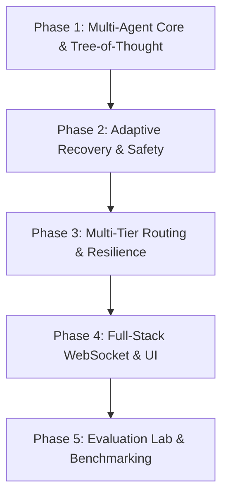

# Sentinel AI 2.0 — Implementation Roadmap & Execution History

## 1. Roadmap Architecture & Execution Phasing

This document records the standalone technical implementation roadmap of Sentinel AI 2.0, detailing the exact engineering steps, component files, and verification milestones executed across its 5 architectural phases:

---

## 2. Phase-by-Phase Technical Breakdown

### Phase 1: Multi-Agent Core & Tree-of-Thought Planning
**Objective:** Transition from legacy single-agent ReAct loops to a coordinated multi-specialist pipeline.

- [x] **Task 1.1: EventBus & Agent Context Foundations (`backend/orchestrator/base.py`)**
  - Implement thread-safe `EventBus` with subscriber registration and sequence counter (`seq`).
  - Define `AgentContext` dataclass containing goal, acceptance criteria, router, cost tracker, and vector store.
  - Implement `Agent` base class with `_llm_chat` wrapper, token estimation, and telemetry attribution.

- [x] **Task 1.2: Tree-of-Thought Orchestrator (`backend/orchestrator/orchestrator.py`)**
  - Implement `ORCH_SYSTEM_PROMPT` generating 3 candidate paths (`P1`, `P2`, `P3`) with confidence scores.
  - Implement `EXEC_PLAN_PROMPT` decomposing the winning path into typed subtasks (`coder`, `critic`, `executor`).
  - Add visual graph nodes for candidate branches and selected execution paths.

- [x] **Task 1.3: RAG-Assisted Coder Agent (`backend/orchestrator/coder.py`)**
  - Implement Coder with `VectorStore` memory recall of past solutions.
  - Implement AST parsing and double-escaped newline unescaping (`ast.parse`).
  - Add regex fallback parsers for broken JSON outputs.

- [x] **Task 1.4: LLM-as-a-Judge Critic Agent (`backend/orchestrator/critic.py`)**
  - Implement 4-axis scoring rubric (Correctness, Edge Cases, Acceptance, Readability).
  - Implement dynamic score scaling when LLM returns 0–40 sums.
  - Enforce strict $\ge 80/100$ approval threshold with structured issue extraction.

- [x] **Task 1.5: Sandboxed Subprocess Executor (`backend/orchestrator/executor.py`)**
  - Implement `RunPythonTool` integration executing inside an isolated tempdir.
  - Implement regex traceback parser extracting line, exception name, and failure kind.
  - Add benign stderr filtering for test runners.

**Phase 1 Gate:** Offline pipeline integration test (`test_multiagent_pipeline.py`) completes end-to-end using `_ScriptedProvider`.

---

### Phase 2: Adaptive Recovery, AST Guardrails & Escalation
**Objective:** Equip the pipeline with targeted failure recovery and human-in-the-loop safeguards.

- [x] **Task 2.1: Pre-Execution AST Safety Guardrails (`backend/safety/guardrails.py`)**
  - Implement regex pre-filter for dangerous shell commands (`os.system`, recursive deletions).
  - Implement AST visitor scanning for banned imports (`ctypes`, `socket`, `multiprocessing`).
  - Block dynamic `eval()` and `exec()` on non-literal strings.

- [x] **Task 2.2: Adaptive RetryRouter (`backend/orchestrator/retry.py`)**
  - Implement `classify()` classifying tracebacks into `SYNTAX`, `LOGIC`, and `EXTERNAL`.
  - Implement `LINE_PATCH` strategy for syntax errors targeting specific line numbers.
  - Implement `FULL_REWRITE` strategy for logic errors.
  - Implement `BACKOFF` strategy with exponential backoff and random jitter.

- [x] **Task 2.3: Human-in-the-Loop EscalationManager (`backend/orchestrator/escalation.py`)**
  - Implement moving average confidence tracker across attempts.
  - Implement escalation trigger when `attempts >= 2` and `confidence < 0.50`.
  - Implement `wait_until_answer()` with configurable timeouts and event emission (`needs_human_review`).

- [x] **Task 2.4: Local TF-IDF VectorStore Memory (`backend/memory/vector_store.py`)**
  - Implement local disk-backed persistence in `~/.sentinel_ai/memory/memory.json`.
  - Implement cosine similarity vector search over TF-IDF token weights.
  - Store solved implementations and error signatures for cross-run learning.

- [x] **Task 2.5: Cost & Token Telemetry (`backend/orchestrator/cost.py`)**
  - Implement `CostTracker` recording input tokens, output tokens, and calculated USD costs.
  - Enforce `TokenBudget` ceilings, cleanly aborting execution if budget limits are hit.

**Phase 2 Gate:** Unit tests for taxonomy, retry router, escalation, and vector store pass (155 tests green).

---

### Phase 3: Multi-Tier Provider Routing & Free-Tier Resilience
**Objective:** Deliver 100% reliable inference across 7 free and commercial LLM providers without hardcoded model strings.

- [x] **Task 3.1: Multi-Tier Architecture (`backend/config.py`, `backend/llm/router.py`)**
  - Define 3 semantic model tiers: `strategic`, `coding`, and `fast_eval`.
  - Configure provider chains for Groq, NVIDIA NIM, OpenRouter, SambaNova, OpenCode, Cohere, Cerebras.

- [x] **Task 3.2: Dynamic Catalog Model Discovery (`backend/llm/openai_provider.py`)**
  - Implement dynamic `/v1/models` catalog lookup on initialization.
  - Filter out invalid families (whisper, dall-e, embedding, guardrails).
  - Classify models by parameter size indicators (70B/120B into heavy, 8B/27B into light).

- [x] **Task 3.3: Reactive 429 Backoff & Token-per-Day (TPD) Rotation**
  - Implement 2-second sleep on HTTP 429 rate limits.
  - Rotate to alternative fallback models when free-tier TPD quotas are hit on a specific model ID.
  - Maintain provider `fail_count` sorting to sink failing endpoints automatically.

- [x] **Task 3.4: Cohere Rate-Limit Throttling (`backend/llm/cohere_provider.py`)**
  - Implement 6-second inter-call throttle to prevent bursting the trial tier.
  - Fail-fast on 429 to avoid hammering rate-limited keys.

**Phase 3 Gate:** LLMRouter passes all failover tests and recovers from injected 429 errors seamlessly.

---

### Phase 4: Full-Stack WebSocket Layer & ReactFlow UI
**Objective:** Provide an interactive, developer-first visual console for monitoring multi-agent execution in real time.

- [x] **Task 4.1: FastAPI WebSocket Server (`backend/server/server.py`)**
  - Implement full-duplex WebSocket handler at `/ws`.
  - Connect WebSocket client queue to `EventBus` for streaming `AgentEvent` payloads.
  - Handle client messages: `run`, `stop`, `escalation_response`.

- [x] **Task 4.2: SQLite3 History Store (`backend/db/store.py`)**
  - Implement SQLite database storing run metadata, goals, elapsed times, tokens, and costs.
  - Expose `/api/runs` and `/api/runs/{run_id}` HTTP inspection endpoints.

- [x] **Task 4.3: ReactFlow Visual Graph Canvas (`frontend/src/components/AgentGraph.tsx`)**
  - Render node-edge DAG with dynamic status coloring (active, success, rejected, candidate).
  - Display animated edges indicating active agent transitions.

- [x] **Task 4.4: Real-Time Telemetry & Terminal (`frontend/src/components/Terminal.tsx`, `Telemetry.tsx`)**
  - Stream terminal logs, stdout, stderr, and RAG recall events.
  - Display real-time token counts, USD expenditure, and active provider pills.

- [x] **Task 4.5: Human Escalation Modal (`frontend/src/components/EscalationModal.tsx`)**
  - Modal dialogue rendered upon receiving `needs_human_review` event.
  - Allows developer to type an advice string that resumes backend execution.

**Phase 4 Gate:** Browser connects to WebSocket, submits goal, renders live ReactFlow graph, and receives complete code artifact.

---

### Phase 5: Evaluation Lab & Empirical Verification
**Objective:** Measure and prove the real-world performance lift of autonomous self-correction.

- [x] **Task 5.1: Evaluation Engine (`backend/eval_suite.py`)**
  - Implement `run_evaluation_suite()` automating sequential batch testing across canonical goals.
  - Support A/B execution with Self-Correction enabled (`max_retries = 3`) and baseline (`max_retries = 1`).
  - Output structured JSON trace per run and consolidated `summary.json`.

- [x] **Task 5.2: 12 Canonical Coding Goals (`run_custom_test.py`)**
  - Create standardized 12-task benchmark suite covering data structures, algorithms, CSV processing, Fibonacci repair, matrix multiplication, and error recovery.

- [x] **Task 5.3: Benchmark Run Execution & Result Verification (`eval_1791864368`)**
  - Execute full 24-run evaluation suite.
  - Verify **100.0% completion rate (Self-Correction ON)** vs **75.0% Baseline (OFF)**.
  - Record complete benchmark report in [`docs/BENCHMARK_REPORT.md`](./BENCHMARK_REPORT.md).

**Phase 5 Gate:** Evaluation suite executes cleanly with zero unhandled API crashes and produces verified 100% completion metrics.
