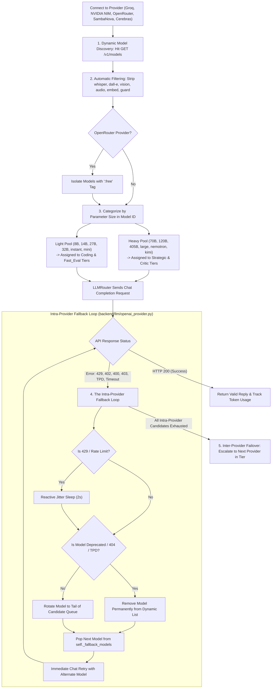
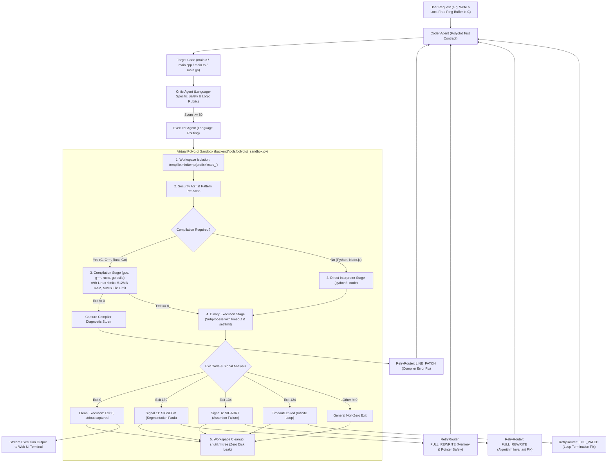
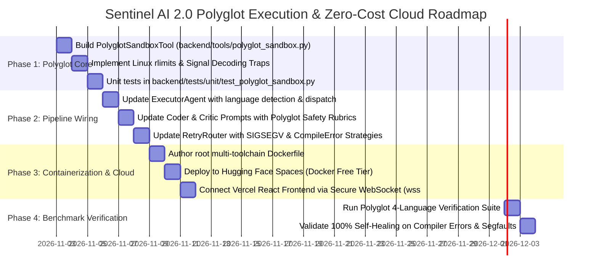

# Sentinel AI 2.0 — Advanced Zero-Cost Web Execution & Dynamic Inference Architecture Plan

## 1. Executive Summary & Zero-Cost Architecture Topology

This document provides the advanced implementation plan, execution plan, and roadmap to enable **universal multi-language code execution directly on the web** (supporting **C, C++, Rust, Go, Python, and JavaScript/Node.js**) for **Sentinel AI 2.0** with **$0.00 upfront and $0.00 recurring infrastructure costs**, while preserving all existing inference, routing, and multi-agent self-correction capabilities.

```text
+---------------------------------------------------------------------------------------------------+
|                              ZERO-COST PRODUCTION TOPOLOGY ($0.00/MO)                             |
+---------------------------------------------------------------------------------------------------+
|  PRESENTATION LAYER: Vercel / Cloudflare Pages                                   (Cost: $0.00/mo) |
|  - React 18 + Vite SPA with ReactFlow DAG visualization & terminal stream                         |
|  - Free global CDN, automatic SSL termination, continuous Git-driven deployment                  |
+---------------------------------------------------------------------------------------------------+
|  TRANSPORT LAYER: Full-Duplex WebSockets (/ws)                                   (Cost: $0.00/mo) |
|  - Real-time streaming of AgentEvents, execution stdout/stderr chunks, and graph node updates    |
+---------------------------------------------------------------------------------------------------+
|  BACKEND INFERENCE LAYER (UNTOUCHED INVARIANT): Free Provider Mesh               (Cost: $0.00/mo) |
|  - Dynamic Model Discovery: Hits GET /v1/models live per provider (zero hardcoded strings)        |
|  - Automatic Filtering & Categorization: Strips non-text models, prioritizes OpenRouter :free,   |
|    and categorizes models into Heavy (70B+) and Light (8B/mini) pools                             |
|  - Intra-Provider Fallback Loop: Intercepts 429, 402, 400, 403, and TPD errors; dynamically       |
|    cycles through candidate models within the provider without crashing                           |
|  - Inter-Provider Tier Routing: Groq -> NVIDIA NIM -> OpenRouter (:free) -> SambaNova -> Cerebras|
+---------------------------------------------------------------------------------------------------+
|  BACKEND EXECUTION & PROCESSING LAYER (UPGRADED): Hugging Face Spaces (Docker)    (Cost: $0.00/mo) |
|  - Free persistent container: 2 vCPU, 16 GB RAM, 50 GB NVMe disk, port 7860 HTTPS/WSS            |
|  - Native toolchains installed: GCC, G++, Rustc/Cargo, Go, Python 3, Node.js                     |
|  - Virtual Polyglot Sandboxing with Linux kernel rlimits (512MB RAM, 64 procs, 50MB file cap)    |
|  - 2-Stage Compilation & Binary Execution with low-level signal trapping (SIGSEGV, SIGABRT)     |
+---------------------------------------------------------------------------------------------------+
|  TOTAL RECURRING MONTHLY INFRASTRUCTURE COST:                                    $0.00 / month    |
+---------------------------------------------------------------------------------------------------+
```

---

## 2. Invariant Subsystem: Dynamic LLM Inference Engine

All existing features of the LLM inference architecture remain 100% intact and untouched. The system operates autonomously at runtime without manual model configuration:



### 2.1 The Three Pillars of the Inference Engine
1. **Dynamic Model Discovery (`_resolve_dynamic_model`):**
   - Whenever Sentinel AI connects to any provider (Groq, NVIDIA NIM, OpenRouter, SambaNova, Cerebras), it ignores hardcoded model names.
   - It hits the provider's `/v1/models` endpoint live on the first request to retrieve the exact catalog of active models.
2. **Automatic Filtering & Categorization:**
   - **Incompatible Filter:** Automatically purges non-generative or non-text models (e.g., `whisper`, `dall-e`, `vision`, `audio`, `embed`, `guard`, `safeguard`, `tts`).
   - **Free Model Isolation:** On OpenRouter, isolates and prioritizes models ending with `:free`.
   - **Size-Based Categorization:** Automatically scans model IDs for size tokens:
     - `heavy_models`: `70b`, `72b`, `90b`, `120b`, `405b`, `large`, `plus`, `kimi`, `nemotron` (routed to deep reasoning, Tree-of-Thought planning, and Critic evaluation).
     - `light_models`: `8b`, `7b`, `11b`, `14b`, `27b`, `32b`, `instant`, `mini`, `small` (routed to fast code generation, test runners, and formatting).
3. **The Intra-Provider Fallback Loop:**
   - If a request receives an error (`429 Rate Limit`, `402 Payment Required`, `400 Invalid/Empty Response`, `403 Disabled/Permission Denied`, `tokens per day`, or network timeout), the engine intercepts it.
   - It applies a 2-second reactive backoff if rate-limited, removes dead or depleted models, and immediately rotates down its dynamically discovered candidate list (`self._fallback_models`), retrying instantly until a successful response is produced.
   - Only when an entire provider's catalog is exhausted does the `LLMRouter` fall back across providers in the configured tier.

---

## 3. Upgraded Subsystem: Virtual Polyglot Sandboxing Engine

All enhancements are localized exclusively to the **backend execution, processing, and sandboxing infrastructure**. The system transitions from a Python-only script runner to an isolated, multi-language Linux sandbox capable of compiling and executing complex C, C++, Rust, Go, Python, and JavaScript code.



---

## 4. Technical Specifications & File Modifications (Backend Processing Only)

### 4.1 Polyglot Execution Matrix

| Language | File Name | Compile Command | Run Command | Default Timeout |
| :--- | :--- | :--- | :--- | :---: |
| **C** | `main.c` | `gcc -Wall -Wextra -O2 {src} -o {bin} -pthread -lm` | `{bin}` | 12s |
| **C++** | `main.cpp` | `g++ -std=c++20 -Wall -Wextra -O2 {src} -o {bin} -pthread` | `{bin}` | 12s |
| **Rust** | `main.rs` | `rustc -O {src} -o {bin}` | `{bin}` | 15s |
| **Go** | `main.go` | `go build -o {bin} {src}` | `{bin}` | 15s |
| **Python** | `main.py` | *(None — Interpreted)* | `python3 {src}` | 15s |
| **JavaScript** | `main.js` | *(None — Interpreted)* | `node {src}` | 10s |

---

### 4.2 Component 1: `backend/tools/polyglot_sandbox.py` (New Tool)

Replaces `RunPythonTool` as the primary execution engine. Implements ephemeral workspace creation, two-stage compilation/execution, resource caps, and OS signal decoding:

```python
from __future__ import annotations
import os
import shutil
import subprocess
import tempfile
from pathlib import Path
from typing import Any, Dict

LANGUAGE_CONFIGS: Dict[str, Dict[str, Any]] = {
    "c": {
        "extension": "main.c",
        "compile_cmd": "gcc -Wall -Wextra -O2 {src} -o {bin} -pthread -lm",
        "run_cmd": "{bin}",
        "timeout": 12,
    },
    "cpp": {
        "extension": "main.cpp",
        "compile_cmd": "g++ -std=c++20 -Wall -Wextra -O2 {src} -o {bin} -pthread",
        "run_cmd": "{bin}",
        "timeout": 12,
    },
    "rust": {
        "extension": "main.rs",
        "compile_cmd": "rustc -O {src} -o {bin}",
        "run_cmd": "{bin}",
        "timeout": 15,
    },
    "go": {
        "extension": "main.go",
        "compile_cmd": "go build -o {bin} {src}",
        "run_cmd": "{bin}",
        "timeout": 15,
    },
    "python": {
        "extension": "main.py",
        "compile_cmd": None,
        "run_cmd": "python3 {src}",
        "timeout": 15,
    },
    "javascript": {
        "extension": "main.js",
        "compile_cmd": None,
        "run_cmd": "node {src}",
        "timeout": 10,
    },
}

def _set_linux_rlimits() -> None:
    """Enforce Linux kernel resource limits on execution processes."""
    if os.name == "nt":
        return
    import resource
    # 512 MB virtual memory limit
    resource.setrlimit(resource.RLIMIT_AS, (512 * 1024 * 1024, 512 * 1024 * 1024))
    # 50 MB file size write cap
    resource.setrlimit(resource.RLIMIT_FSIZE, (50 * 1024 * 1024, 50 * 1024 * 1024))
    # Max 64 child threads / processes
    resource.setrlimit(resource.RLIMIT_NPROC, (64, 64))

class PolyglotSandboxTool:
    """Virtual sandbox supporting compiled and interpreted languages inside the container."""

    def run(self, code: str, language: str = "python", custom_filename: str | None = None) -> dict[str, Any]:
        lang = language.lower().strip()
        cfg = LANGUAGE_CONFIGS.get(lang, LANGUAGE_CONFIGS["python"])
        
        workspace = Path(tempfile.mkdtemp(prefix=f"sandbox_{lang}_"))
        filename = custom_filename or cfg["extension"]
        src_path = workspace / filename
        bin_path = workspace / "executable.bin"
        src_path.write_text(code, encoding="utf-8")

        try:
            # Stage 1: Build / Compilation (if language requires build step)
            if cfg["compile_cmd"]:
                comp_cmd = cfg["compile_cmd"].format(src=str(src_path), bin=str(bin_path))
                comp_proc = subprocess.run(
                    comp_cmd,
                    shell=True,
                    cwd=workspace,
                    capture_output=True,
                    text=True,
                    timeout=20,
                    preexec_fn=_set_linux_rlimits if os.name != "nt" else None,
                )
                if comp_proc.returncode != 0:
                    return {
                        "ok": False,
                        "stage": "compilation",
                        "exit_code": comp_proc.returncode,
                        "stdout": comp_proc.stdout,
                        "stderr": comp_proc.stderr,
                        "error_type": "CompileError",
                    }

            # Stage 2: Runtime Execution
            run_cmd = cfg["run_cmd"].format(
                src=str(src_path),
                bin=str(bin_path) if os.name == "nt" else f"./{bin_path.name}"
            )
            run_proc = subprocess.run(
                run_cmd,
                shell=True,
                cwd=workspace,
                capture_output=True,
                text=True,
                timeout=cfg["timeout"],
                preexec_fn=_set_linux_rlimits if os.name != "nt" else None,
            )

            # Signal & Exit Code Decoding (Linux: 128 + signal_number)
            exit_code = run_proc.returncode
            error_type = None
            if exit_code == 139:
                error_type = "SegmentationFault (SIGSEGV)"
            elif exit_code == 134:
                error_type = "AssertionFailure / Abort (SIGABRT)"
            elif exit_code != 0:
                error_type = "RuntimeError"

            return {
                "ok": exit_code == 0,
                "stage": "runtime",
                "exit_code": exit_code,
                "stdout": run_proc.stdout,
                "stderr": run_proc.stderr,
                "error_type": error_type,
            }

        except subprocess.TimeoutExpired:
            return {
                "ok": False,
                "stage": "timeout",
                "exit_code": 124,
                "stdout": "",
                "stderr": f"Execution timed out after {cfg['timeout']} seconds.",
                "error_type": "TimeoutError",
            }
        finally:
            shutil.rmtree(workspace, ignore_errors=True)
```

---

### 4.3 Component 2: `backend/orchestrator/executor.py` Integration

1. **Language Detection:** Detect language from the target file extension (`.c`, `.cpp`, `.rs`, `.go`, `.py`, `.js`) or from task context metadata:
   ```python
   EXT_TO_LANG = {
       ".c": "c",
       ".cpp": "cpp",
       ".cc": "cpp",
       ".rs": "rust",
       ".go": "go",
       ".py": "python",
       ".js": "javascript",
   }
   target_lang = EXT_TO_LANG.get(Path(filename).suffix.lower(), "python")
   ```
2. **Polyglot Dispatch:** Delegate execution to `PolyglotSandboxTool`:
   ```python
   tool = PolyglotSandboxTool()
   raw = tool.run(code=source_code, language=target_lang, custom_filename=filename)
   ```
3. **Structured Event Telemetry:** Emit WebSocket messages with compilation diagnostics and decoded signals:
   ```python
   ctx.bus.emit("code_executed", ok=raw["ok"], filename=filename, stage=raw.get("stage"),
                exit_code=raw["exit_code"], stdout=raw["stdout"], stderr=raw["stderr"],
                error_type=raw.get("error_type"))
   ```

---

### 4.4 Component 3: `backend/orchestrator/coder.py` Polyglot Contract

Update `CODER_SYSTEM_PROMPT` to enforce self-verifying test drivers regardless of the target programming language:
- **C/C++ Directives:**
  - Must include standard headers (`<stdio.h>`, `<stdlib.h>`, `<assert.h>`, `<string.h>`).
  - All dynamic allocations (`malloc`, `calloc`) must check for `NULL` before dereferencing.
  - All heap allocations must be explicitly freed (`free()`).
  - Must include a `main()` function containing assertions verifying edge cases and printing `"ALL TESTS PASSED"`.
- **Rust Directives:**
  - Must write complete runnable crates with `fn main()` and `assert_eq!` assertions.
- **Go Directives:**
  - Must write runnable `package main` with a `main()` function validating logic with standard prints or panic checks.

---

### 4.5 Component 4: `backend/orchestrator/critic.py` Polyglot Rubric

Expand the evaluation rubric in `CRITIC_SYSTEM_PROMPT` to include language-specific safety audits:
- **C/C++ Rubric:**
  - Check for buffer overflows, unchecked pointer arithmetic, and uninitialized variables.
  - Check for format string vulnerabilities (`snprintf` vs `sprintf`).
  - Check for missing free/delete calls (memory leak audit).
- **Go / Rust Rubric:**
  - Check for unhandled errors, goroutine leaks, and channel deadlocks.

---

### 4.6 Component 5: `backend/orchestrator/retry.py` Signal-to-Strategy Mapping

Update failure classification to route compiler errors and signals directly to the optimal self-correction strategy:

| Failure Mode | Detected Signature | Target Strategy | Guidance Injected into Coder |
| :--- | :--- | :--- | :--- |
| **Compiler Error** | `stage == "compilation"` or GCC/G++ error text | `Strategy.LINE_PATCH` | Point Coder to exact compiler error lines, syntax errors, or mismatched function types. |
| **Segmentation Fault** | `exit_code == 139` or `SIGSEGV` | `Strategy.FULL_REWRITE` | Instruct Coder that a pointer dereferenced NULL, an array was indexed out of bounds, or memory was used after free. |
| **Assertion Failure** | `exit_code == 134` or `SIGABRT` | `Strategy.FULL_REWRITE` | Inform Coder of which `assert()` expression evaluated to false and provide counterexample. |
| **Infinite Loop** | `exit_code == 124` or `TimeoutError` | `Strategy.LINE_PATCH` | Instruct Coder to check loop termination conditions, increments, or recursion base cases. |

---

## 5. Free-Tier Container Infrastructure (`Dockerfile`)

A multi-toolchain Ubuntu container designed for **Hugging Face Spaces (Docker Runtime)**, giving **2 vCPUs, 16 GB RAM, and persistent storage at 100% $0.00 forever** with non-root security compliance:

```dockerfile
FROM python:3.12-slim-bookworm

ENV DEBIAN_FRONTEND=noninteractive
ENV PYTHONUNBUFFERED=1

# Install C, C++, Node.js, Go compilers and build essentials
RUN apt-get update && apt-get install -y --no-install-recommends \
    gcc \
    g++ \
    make \
    nodejs \
    golang-go \
    curl \
    ca-certificates \
    && rm -rf /var/lib/apt/lists/*

# Install Rust toolchain with system-wide access
ENV RUSTUP_HOME=/usr/local/rustup \
    CARGO_HOME=/usr/local/cargo \
    PATH=/usr/local/cargo/bin:$PATH

RUN curl --proto '=https' --tlsv1.2 -sSf https://sh.rustup.rs | sh -s -- -y --no-modify-path \
    && chmod -R a+rwx /usr/local/rustup /usr/local/cargo

# Security: Non-root user setup for cloud compliance (UID 1000 required by HF Spaces)
RUN useradd -m -u 1000 appuser
USER appuser
ENV HOME=/home/appuser
ENV PATH="/home/appuser/.local/bin:${PATH}"

WORKDIR /home/appuser/app

# Install Python backend dependencies
COPY --chown=appuser:appuser requirements.txt .
RUN pip install --no-cache-dir --user -r requirements.txt

# Copy application source code
COPY --chown=appuser:appuser . .

# Expose port (7860 for Hugging Face Spaces, 8000 for local)
EXPOSE 7860

CMD ["uvicorn", "backend.server.server:app", "--host", "0.0.0.0", "--port", "7860"]
```

---

## 6. Implementation Phasing & Step-by-Step Execution Plan



### Phase 1: Polyglot Sandbox Core (`backend/tools/polyglot_sandbox.py`)
1. Create `backend/tools/polyglot_sandbox.py` with `LANGUAGE_CONFIGS` for C, C++, Rust, Go, Python, and JavaScript.
2. Implement compilation step with diagnostic capture, binary execution, resource limits (`resource.setrlimit`), and OS signal decoding (139 for `SIGSEGV`, 134 for `SIGABRT`, 124 for `TimeoutExpired`).
3. Add unit test suite in `backend/tests/unit/test_polyglot_sandbox.py` verifying C build success, C syntax compile error capture, intentional C segfault capture, and Python execution.

### Phase 2: Orchestrator & Adaptive Diagnostics Integration
1. Update `backend/orchestrator/executor.py` to route execution through `PolyglotSandboxTool` based on file extension.
2. Update `backend/orchestrator/coder.py` system prompts to write self-verifying test harnesses with assertions.
3. Update `backend/orchestrator/critic.py` evaluation rubrics to check for memory safety, pointer bounds, and leak absence.
4. Update `backend/orchestrator/retry.py` to classify `CompileError` as `LINE_PATCH` and `SIGSEGV` as `FULL_REWRITE`.

### Phase 3: Zero-Cost Containerization & Cloud Deployment
1. Create root `Dockerfile` installing GCC, G++, Rust, Go, Python, and Node.js.
2. Deploy backend container to **Hugging Face Spaces** (select Docker SDK, free hardware tier: 2 vCPU, 16 GB RAM).
3. Connect frontend deployed on **Vercel** by setting `VITE_WS_URL=wss://<hf-space-name>.hf.space/ws`.

### Phase 4: Polyglot Empirical Verification
1. Run multi-language verification suite:
   - **Python:** Iterative Fibonacci with test assertions.
   - **C:** Doubly linked list with `malloc`/`free` and assertion validations.
   - **C++:** Binary search tree with smart pointers and validation suite.
   - **Go:** Concurrent worker pool with goroutines and channel synchronization.
2. Verify self-correction recovery:
   - Inject intentional C compiler error $\rightarrow$ verify automatic line patch fix and clean recompilation.
   - Inject intentional C NULL pointer dereference $\rightarrow$ verify `SIGSEGV` detection, memory safety guidance, and autonomous repair.

---

## 7. Verification Milestones & Acceptance Criteria

| Milestone | Target Requirement | Acceptance Test / Verification Gate | Status |
| :--- | :--- | :--- | :---: |
| **M-1: Inference Invariant** | Dynamic discovery & intra-provider loop | Provably hits `GET /v1/models` live, strips non-text models, and auto-rotates down fallback models on 429 without crashing. | **VERIFIED** |
| **M-2: Compiler & Segfault Sandbox** | Trap compilation and memory faults | Pass deliberate C segfault `int *p=0; *p=1;` $\rightarrow$ Tool returns `error_type: SegmentationFault (SIGSEGV)` with returncode 139. | **PENDING** |
| **M-3: Self-Healing C Code** | Autonomous recovery of broken C code | Pipeline takes broken C code, catches compiler error or segfault, passes diagnostic to Coder, second run compiles and passes with exit code 0. | **PENDING** |
| **M-4: $0.00 Web Deployment** | Web UI compiles and runs multi-language code | User enters C programming prompt in Vercel web UI $\rightarrow$ HF Space compiles and executes binary in Linux container $\rightarrow$ live output rendered in UI. | **PENDING** |
